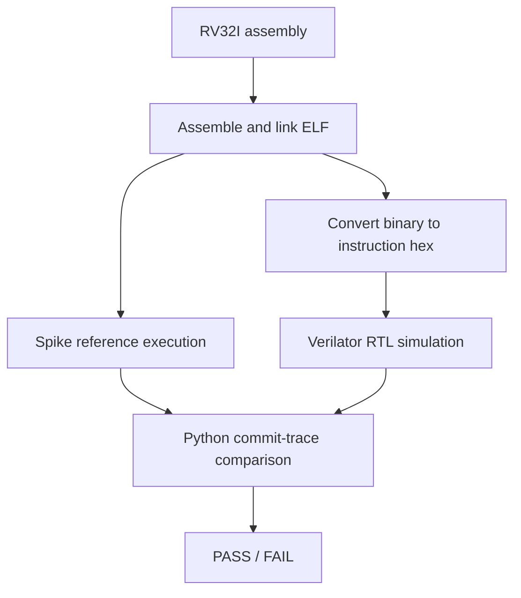

# RV32I CPU — Five-Stage Pipeline and Differential Verification

A single-issue, in-order, five-stage **SystemVerilog RISC-V integer CPU** with operand forwarding, load-use hazard handling, branch recovery, and architectural differential verification against [Spike](https://github.com/riscv-software-src/riscv-isa-sim).

The project compares two approaches to load-use dependencies: **pipeline interlocking** and **direct MEM-to-EX forwarding**. Both variants pass a 13-program CPU regression. On an eight-element insertion-sort benchmark, direct forwarding reduces the cycle count from **330 to 310 (6.1%)** and mapped standard-cell area by **1.95%**, while introducing a longer combinational memory-to-execution path.

## Microarchitecture

```text
 PC ──► [ IF ] ──► IF/ID ──► [ ID ] ──► ID/EX ──► [ EX ] ──► EX/MEM ──► [ MEM ] ──► MEM/WB ──► [ WB ]
         Fetch                Decode                 ALU / branch              Load / store             Writeback
```

*Five-stage pipeline overview. Forwarding, stalls, and redirects are described below.*

The stages are separated by `IF/ID`, `ID/EX`, `EX/MEM`, and `MEM/WB` pipeline registers. Each interstage record carries a validity bit so bubbles and flushed instructions do not produce architectural side effects.

| Stage | Main responsibilities |
| --- | --- |
| **IF — Instruction fetch** | Select the next PC and read an instruction through the instruction-memory interface. |
| **ID — Decode** | Decode the instruction, generate immediates, read the register file, and detect load-use dependencies in the interlocked baseline. |
| **EX — Execute** | Select forwarded operands, perform ALU operations, compare branch operands, and resolve branches/jumps. |
| **MEM — Memory access** | Read or write data through byte-addressed load/store logic with byte write strobes. |
| **WB — Writeback** | Select the ALU, memory, immediate, or `PC + 4` result and update the destination register. |

The processor uses a 32-bit program counter (reset address `0x8000_0000`), a 32-register integer register file with `x0` hardwired to zero, and separate instruction- and data-memory interfaces. The included `rv32i_system` wrapper instantiates the core and a simple data-memory model; instruction memory is supplied by the simulation testbench.

### Hazard handling and control flow

The main challenge is handling dependencies between instructions that are simultaneously in flight.

| Situation | Mechanism |
| --- | --- |
| ALU result used by a following instruction | Forward from `EX/MEM` or `MEM/WB` to the EX operands, prioritizing the newer producer. |
| Register-file value written back during decode | Bypass the `MEM/WB` value into the ID-stage operand reads. |
| Load immediately followed by a dependent instruction | Baseline: hold PC and `IF/ID`, inserting a bubble into `ID/EX`. Experimental variant: forward combinational MEM-stage load data directly into EX. |
| Store needs recently produced data | Forward store data from `MEM/WB` in the MEM stage when needed. |
| Taken branch or jump | Resolve in EX, redirect the PC, and invalidate younger instructions. |

The interlocked baseline stalls on immediate load-use dependencies until the loaded value becomes available through a later forwarding path. The experimental variant instead forwards the combinational load result directly into EX, eliminating this stall at the cost of a longer path through the memory interface, forwarding logic, and execution logic.

Branches and jumps are resolved in EX. When the PC changes, the design flushes the younger instructions that were fetched or decoded along the old path. Invalid instructions and bubbles are suppressed through the pipeline's `valid` fields.

## Instruction and memory support

The decoder implements the arithmetic, logical, shift, comparison, upper-immediate, branch, jump, and load/store instruction families used by the RV32I test programs.

| Group | Supported operations |
| --- | --- |
| Integer arithmetic and logic | Register and immediate operations, shifts, signed/unsigned comparisons |
| Control flow | Conditional branches, `JAL`, `JALR` |
| Upper immediates | `LUI`, `AUIPC` |
| Loads | `LB`, `LBU`, `LH`, `LHU`, `LW` |
| Stores | `SB`, `SH`, `SW` |

Data memory uses a little-endian byte array with combinational word reads and synchronous, byte-enabled writes. The provided model defaults to **1 KiB** beginning at `0x8000_0000`; the testbench supplies a separate combinational instruction-memory model. The memory interfaces have no ready/valid handshake or variable-latency response mechanism.

**Scope:** This is an RV32I-oriented educational core, not a complete RISC-V platform. There is no exception/trap or CSR subsystem; illegal instruction encodings are suppressed rather than trapped, and misaligned loads/stores do not generate architectural exceptions. See [Limitations](#limitations).

## Verification

### Directed component testing

Self-checking SystemVerilog testbenches exercise the ALU, branch comparator, decoder, immediate generator, and register file. These complement, rather than replace, full-program tests of the integrated processor.

### Spike differential testing

The CPU regression tests run assembly programs through two execution paths:



The testbench emits an ordered record for each instruction reaching the commit point. `scripts/compare_traces.py` compares **PC, instruction encoding, register writeback, and recorded memory address/data effects** against Spike, reporting the first divergent commit. The comparator does **not** independently compare the memory byte-enable mask; separate directed tests and the insertion-sort memory check cover additional behavior.

Both CPU variants pass the same **13-program Spike differential regression**, covering forwarding, load-use dependencies, ALU operations, branches, jumps, subword loads/stores, loops, and an eight-element insertion sort. For insertion sort, the testbench additionally checks the final array in memory. The repository also includes separate programs for illegal and misaligned instruction/access cases; these are not part of the 13-program Spike regression.

The five-stage processor and Spike do not have the same internal cycle-by-cycle behavior. Comparing *retired architectural effects* avoids false mismatches caused by pipeline overlap, while still testing whether instructions execute in the correct order and produce the expected results.


## Microarchitectural Design Exploration

### Load-use handling

Two implementations of the same five-stage pipeline were evaluated:

| Variant | RTL | Load-use handling |
| --- | --- | --- |
| **Interlocked baseline** | [`rtl/rv32i_core.sv`](rtl/rv32i_core.sv) | Stall the dependent instruction until the load result can be forwarded. |
| **Direct MEM-to-EX** | [`rtl/rv32i_core_memex.sv`](rtl/rv32i_core_memex.sv) | Forward combinational MEM-stage load data into EX without inserting a load-use bubble. |

Both variants use the same instruction set, test programs, simulation memory model, and verification flow.

### Execution and synthesis results

The benchmark executes an eight-element insertion sort until **246 instructions commit**, with the final sorted array independently checked in the testbench. Both variants match Spike's architectural commit trace.

| Metric | Interlocked baseline | Direct MEM-to-EX | Change |
| --- | ---: | ---: | ---: |
| Execution cycles | 330 | 310 | **−6.1%** |
| Committed instructions | 246 | 246 | — |
| CPI | 1.341 | 1.260 | −6.1% |
| Mapped standard cells | 8,670 | 8,273 | −4.6% |
| Mapped cell area | 15,541.848 | 15,238.874 | **−1.95%** |

Synthesis uses Yosys with the Nangate Open Cell Library (typical corner), applying the same `synth`, `dfflibmap`, `abc -D 10000`, and `stat` sequence to both implementations.

The area figures are pre-layout standard-cell estimates, not physical silicon area. In particular, the behavioral register file is mapped into standard cells rather than a dedicated memory macro.

### Static timing analysis

OpenSTA was used to evaluate the mapped designs under a **10 ns clock constraint**, ideal clocks, and several assumed input delays on `dmem_rdata`.

| Assumed DMEM input delay | Baseline input-to-register path | Direct-forwarding input-to-register path |
| ---: | ---: | ---: |
| 0 ns | 0.38 ns | 2.33 ns |
| 1 ns | 1.38 ns | 3.33 ns |
| 2 ns | 2.38 ns | 4.33 ns |
| 3 ns | 3.38 ns | 5.33 ns |

The direct-forwarding implementation has a **1.95 ns longer worst reported memory-input-to-register path**. The mapped path traverses forwarding selection and downstream ALU logic, demonstrating the combinational timing cost of removing load-use stalls.

However, the longest reported register-to-register paths are substantially larger:

| Timing metric | Interlocked baseline | Direct MEM-to-EX |
| --- | ---: | ---: |
| Worst register-to-register data arrival | 18.08 ns | 18.05 ns |
| Overall worst slack at 10 ns | −8.20 ns | −8.17 ns |

Neither implementation meets the 10 ns constraint. The register-to-register paths dominate the reported worst slack throughout the tested 0–3 ns DMEM input-delay range.

**Design tradeoff:** Direct forwarding reduces CPI for the tested workload and modestly reduces mapped area under this synthesis flow, but introduces a longer memory-to-EX combinational path. The simplified memory model, incomplete system-level timing characterization, and absence of physical implementation prevent a reliable maximum-frequency or execution-time comparison.

## Running the project

Run commands from the repository root in Linux or WSL.

Required tools: Bash, Python 3, Verilator, Spike, RISC-V GNU binutils (`riscv32-unknown-elf-*`), sv2v, Yosys, and OpenSTA (`sta`). The mapped synthesis flow uses the Nangate Open Cell Library (typical corner). Set `LIBERTY` to override the default library path.

```bash
# Single-program smoke test
./scripts/run_cpu_test.sh smoke 4 --no-synth

# Insertion-sort benchmark: both variants
CPU_VARIANT=stall ./scripts/run_cpu_test.sh insertion_sort 246 --no-synth --check-sort
CPU_VARIANT=memex ./scripts/run_cpu_test.sh insertion_sort 246 --no-synth --check-sort

# Complete CPU regression: 13 tests per variant
CPU_VARIANT=stall ./scripts/run_cpu_regression.sh
CPU_VARIANT=memex ./scripts/run_cpu_regression.sh

# Nangate mapped synthesis and OpenSTA comparison
./scripts/compare_cpu_variants.sh

# Component regression example: ALU, 10 seeds
./scripts/run_regression.sh alu 10
```

The CPU simulation writes commit traces and a `RESULT cycles=... commits=...` summary to `results/sim.log`. Individual simulations overwrite this log. The mapped comparison keeps separate synthesis and timing reports under `results/compare/stall/` and `results/compare/memex/`.

## Repository layout

| Path | Contents |
| --- | --- |
| [`rtl/rv32i_core.sv`](rtl/rv32i_core.sv) | Interlocked five-stage pipeline with load-use stalling |
| [`rtl/rv32i_core_memex.sv`](rtl/rv32i_core_memex.sv) | Experimental direct MEM-to-EX forwarding variant |
| [`rtl/rv32i_system.sv`](rtl/rv32i_system.sv) | Core variant selection and data-memory integration |
| [`rtl/`](rtl/) | Decoder, ALU, register file, immediate generator, branch comparator, memory, shared types |
| [`tb/`](tb/) | Component and integrated-system testbenches |
| [`programs/`](programs/) | RV32I assembly test programs covering instructions, hazards, memory operations, and insertion sort |
| [`scripts/`](scripts/) | CPU regression, Spike comparison, variant selection, synthesis, and STA |
| [`rtl/rv32i_core_unpipelined.sv`](rtl/rv32i_core_unpipelined.sv) | Earlier single-cycle-style implementation retained for reference |

## Limitations

- **No traps or privileged architecture:** Illegal encodings become bubbles; misaligned memory accesses do not raise exceptions. CSR instructions, `ECALL`, and `EBREAK` are not implemented.
- **Simplified memory timing:** Instruction and data reads are combinational; there are no caches, arbitration, wait states, or bus transactions.
- **Physical implementation:** The mapped synthesis and STA results are pre-layout estimates. The design has not undergone physical implementation, complete timing closure, power characterization, or memory-macro integration. Timing analysis uses simplified external delays and ideal clocks.
- **Verification scope:** Spike comparison checks the effects included in the emitted traces and the finite assembly suite. It is not an exhaustive proof of RV32I compliance.
