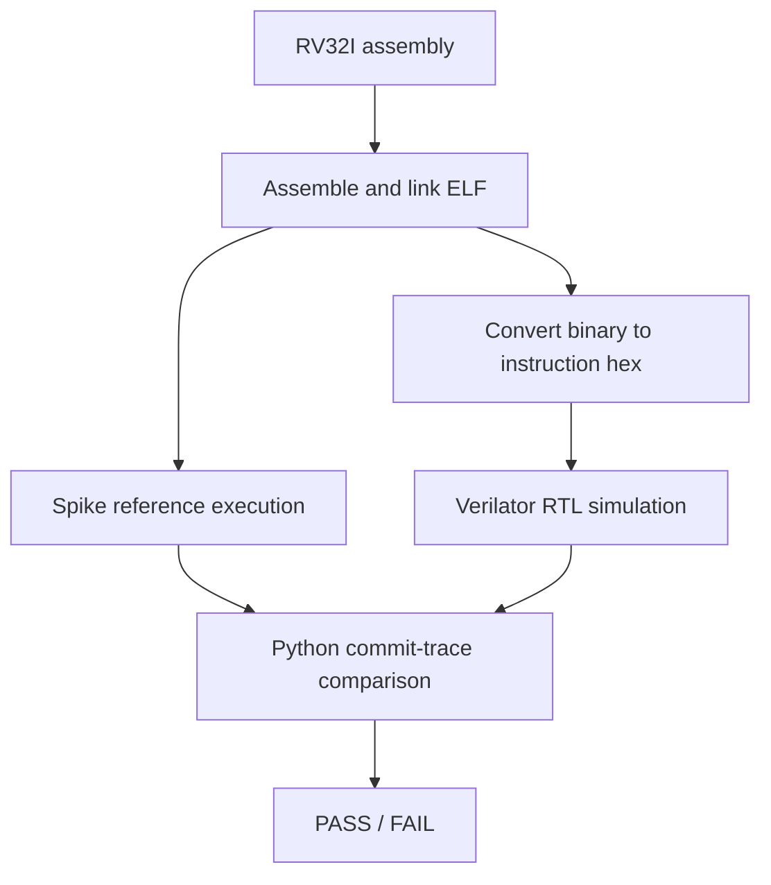

# RV32I CPU — Five-Stage Pipeline and Differential Verification

A SystemVerilog implementation of a **single-issue, in-order, five-stage RISC-V CPU**, with data forwarding, hazard interlocks, branch recovery, and instruction-level differential verification against [Spike](https://github.com/riscv-software-src/riscv-isa-sim).

The project focuses on **microarchitectural correctness**: preserving architectural execution order while instructions overlap in the pipeline. Its verification flow assembles RV32I programs, runs them on both the RTL and the reference simulator, and compares their architectural commit traces.

## Microarchitecture


The stages are separated by `IF/ID`, `ID/EX`, `EX/MEM`, and `MEM/WB` pipeline registers. Each interstage record carries a validity bit so bubbles and flushed instructions do not produce architectural side effects.

| Stage | Main responsibilities |
| --- | --- |
| **IF — Instruction fetch** | Select the next PC and read an instruction through the instruction-memory interface. |
| **ID — Decode** | Decode the instruction, generate immediates, read the register file, and detect load-use dependencies. |
| **EX — Execute** | Select forwarded operands, perform ALU operations, compare branch operands, and resolve branches/jumps. |
| **MEM — Memory access** | Read or write data through byte-addressed load/store logic with byte write strobes. |
| **WB — Writeback** | Select the ALU, memory, immediate, or `PC + 4` result and update the destination register. |

The processor uses a 32-bit program counter (reset address `0x8000_0000`), a 32-register integer register file with `x0` hardwired to zero, and separate instruction- and data-memory interfaces. The included `rv32i_system` wrapper instantiates the core and a simple data-memory model; instruction memory is supplied by the simulation testbench.

### Hazard handling and control flow

The main challenge is handling dependencies between instructions that are simultaneously in flight.

| Situation | Mechanism |
| --- | --- |
| ALU result used by a following instruction | Forward from `EX/MEM` or `MEM/WB` to the EX operands, prioritizing the newer producer. |
| Register-file value written back during decode | Bypass the `MEM/WB` value into the ID-stage operand reads. |
| Load immediately followed by a dependent instruction | Hold the PC and `IF/ID` register, and inject a bubble into `ID/EX`. |
| Store needs recently produced data | Forward store data from `MEM/WB` in the MEM stage when needed. |
| Taken branch or jump | Resolve in EX, redirect the PC, and invalidate younger instructions. |

A load-use dependency cannot be resolved by the `EX/MEM` forwarding path in this implementation: load data is obtained through the MEM-stage interface. The interlock therefore delays a directly dependent instruction until the value can be supplied through a later forwarding path.

Branches and jumps are resolved in EX. When the PC changes, the design flushes the younger instructions that were fetched or decoded along the old path. Invalid instructions and bubbles are suppressed through the pipeline's `valid` fields.

## Instruction and memory support

The decoder implements the arithmetic, logical, shift, comparison, upper-immediate, branch, jump, and load/store instruction families used by the RV32I test programs.

| Group | Supported operations |
| --- | --- |
| Integer arithmetic and logic | Register and immediate operations, shifts, signed/unsigned comparisons |
| Control flow | Conditional branches, `JAL`, `JALR` |
| Upper immediates | `LUI`, `AUIPC` |
| Loads | `LB`, `LBU`, `LH`, `LHU`, `LW` |
| Stores | `SB`, `SH`, `SW` |

Data memory uses a little-endian byte array with combinational word reads and synchronous, byte-enabled writes. The provided model defaults to **1 KiB** beginning at `0x8000_0000`; the testbench supplies a separate combinational instruction-memory model. The memory interfaces have no ready/valid handshake or variable-latency response mechanism.

**Scope:** This is an RV32I-oriented educational core, not a complete RISC-V platform. There is no exception/trap or CSR subsystem; illegal instruction encodings are suppressed rather than trapped, and misaligned loads/stores do not generate architectural exceptions. See [Limitations](#limitations).

## Verification

### Directed component testing

Self-checking SystemVerilog testbenches exercise the ALU, branch comparator, decoder, immediate generator, and register file. These complement, rather than replace, full-program tests of the integrated processor.

### Spike differential testing

The CPU regression tests run assembly programs through two execution paths:



The testbench emits an ordered record for each instruction reaching the commit point. `scripts/compare_traces.py` compares **PC, instruction encoding, register writeback, and recorded memory address/data effects** against Spike, reporting the first divergent commit. The comparator does **not** independently compare the memory byte-enable mask; separate directed tests and the insertion-sort memory check cover additional behavior.

The CPU regression defines **13 assembly tests**, covering forwarding, load-use dependencies, ALU operations, branches, jumps, subword loads/stores, loops, and an eight-element insertion sort. For insertion sort, the testbench additionally checks the final array in memory. The repository also includes separate programs for illegal and misaligned instruction/access cases; these are not part of the 13-program Spike regression.

The five-stage processor and Spike do not have the same internal cycle-by-cycle behavior. Comparing *retired architectural effects* avoids false mismatches caused by pipeline overlap, while still testing whether instructions execute in the correct order and produce the expected results.

## Running the project

Run commands from the repository root in Linux or WSL.

Required tools: Bash, Python 3, Verilator, Spike, RISC-V GNU binutils (`riscv32-unknown-elf-*`), sv2v, and Yosys.

The simulation flow uses Verilator; synthesis additionally requires sv2v and Yosys.

**Run one program against Spike without synthesis:**

```bash
./scripts/run_cpu_test.sh smoke 4 --no-synth
```

**Run insertion sort, check the final memory contents, and synthesize:**

```bash
./scripts/run_cpu_test.sh insertion_sort 246 --check-sort
```

**Run the complete 13-program regression:**

```bash
./scripts/run_cpu_regression.sh
```

**Run a component regression** (example: ALU, 10 seeds):

```bash
./scripts/run_regression.sh alu 10
```

The scripts place synthesis and simulation logs under `results/`, Verilator build artifacts in `obj_dir/`, and assembly/object/binary/hex intermediates in `programs/`. Trace-comparison pass/fail results appear in the terminal.

## Repository layout

| Path | Contents |
| --- | --- |
| [`rtl/rv32i_core.sv`](rtl/rv32i_core.sv) | Five-stage core, interstage registers, hazard and forwarding control |
| [`rtl/rv32i_system.sv`](rtl/rv32i_system.sv) | Core + data-memory wrapper |
| [`rtl/`](rtl/) | Decoder, ALU, register file, immediate generator, branch comparator, memory, shared types |
| [`tb/`](tb/) | Component and integrated-system testbenches |
| [`programs/`](programs/) | RV32I assembly test programs covering instructions, hazards, memory operations, and insertion sort |
| [`scripts/`](scripts/) | Tool flows, Spike invocation, trace comparison, and regression |
| [`rtl/rv32i_core_unpipelined.sv`](rtl/rv32i_core_unpipelined.sv) | Earlier single-cycle-style implementation retained for reference |

## Limitations

- **No traps or privileged architecture:** Illegal encodings become bubbles; misaligned memory accesses do not raise exceptions. CSR instructions, `ECALL`, and `EBREAK` are not implemented.
- **Simplified memory timing:** Instruction and data reads are combinational; there are no caches, arbitration, wait states, or bus transactions.
- **Not production-ready:** The design has not undergone complete ISA compliance testing, formal verification, physical implementation, or timing closure for a particular technology.
- **Verification scope:** Spike comparison checks the effects included in the emitted traces and the finite assembly suite. It is not an exhaustive proof of RV32I compliance.

